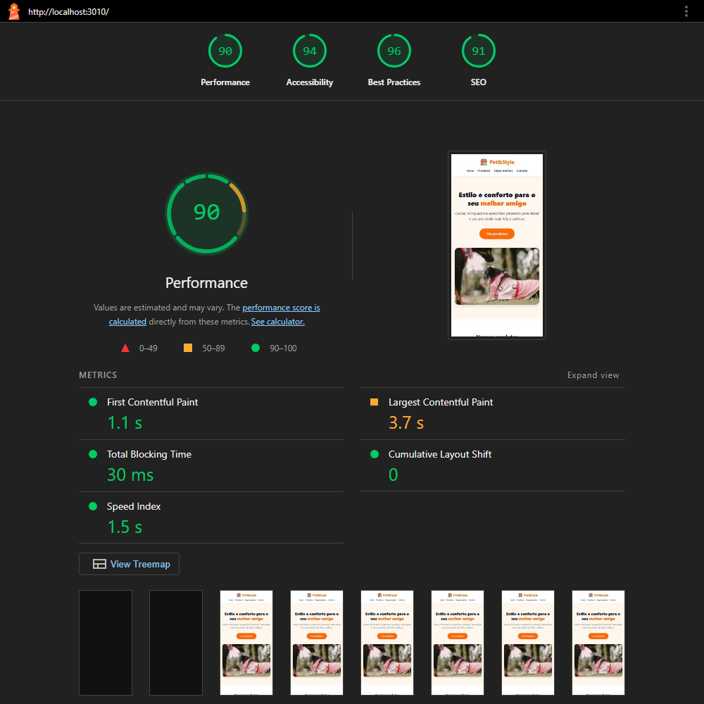
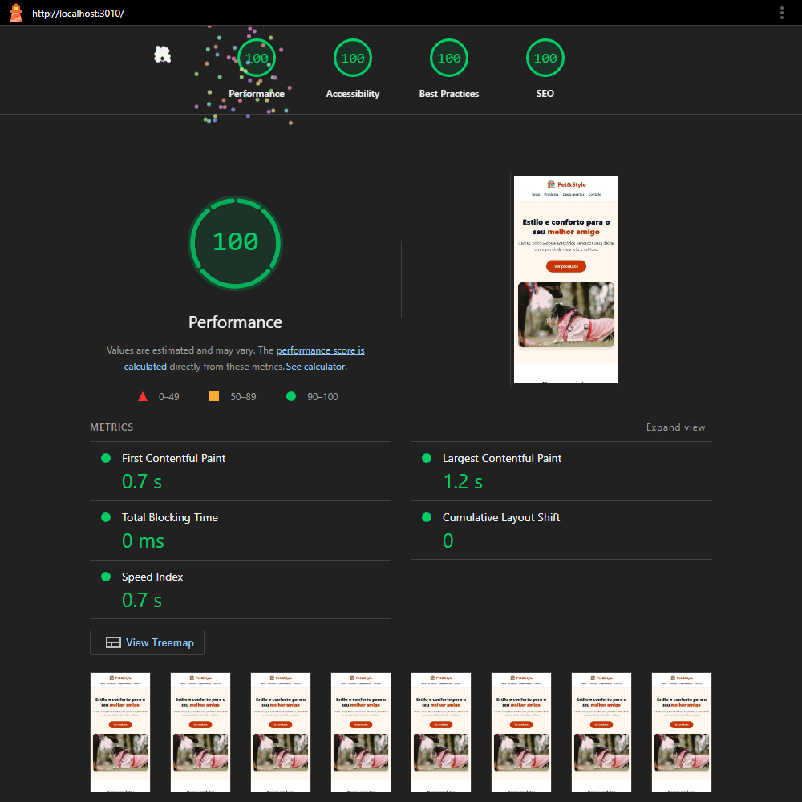
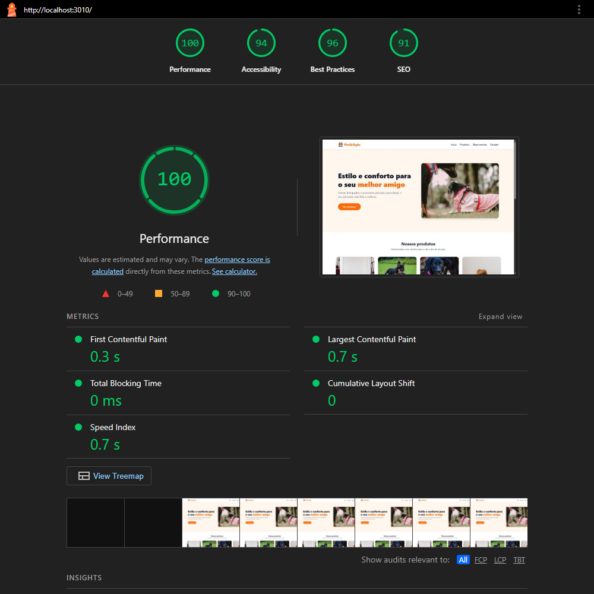
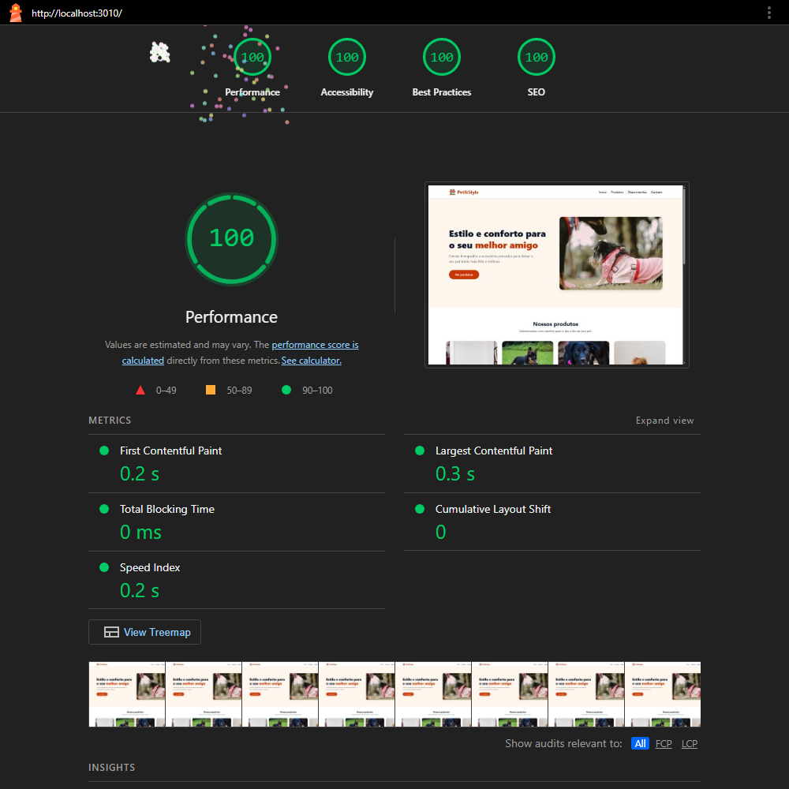

# Pet&Style — Performance e Otimização para a Web

Landing page de produtos para pets, usada na atividade **Performance e Otimização para a Web** da EBAC: medir, diagnosticar e otimizar um projeto real e comprovar a melhoria com números.

| | Antes | Depois |
|---|---|---|
| **Performance (Mobile)** | 90 | **100** |
| **LCP (Mobile)** | 3,66 s | **1,21 s** (−67%) |
| **Peso da página (Mobile)** | 462,4 KB | **98,8 KB** (−79%) |
| **Acessibilidade / Boas práticas / SEO** | 94 / 96 / 91 | **100 / 100 / 100** |

## Sumário

1. [Projeto e stack](#1-projeto-e-stack)
2. [Metodologia de medição](#2-metodologia-de-medição)
3. [Gargalos identificados](#3-gargalos-identificados)
4. [Melhorias aplicadas](#4-melhorias-aplicadas)
5. [Comparativo antes × depois](#5-comparativo-antes--depois)
6. [Conclusão](#6-conclusão)
7. [Como rodar](#7-como-rodar)

## 1. Projeto e stack

- HTML estático + **Tailwind CSS v4.3** (CLI), sem JavaScript e com fontes do sistema.
- O estado original está congelado na tag [`antes`](../../tree/antes).

```
├── index.html            ← GERADO por npm run build (minificado, com o CSS embutido)
├── src/
│   ├── index.html        ← fonte legível da página (edite aqui)
│   ├── input.css         ← entrada do Tailwind (varre só src/index.html)
│   └── output.css        ← CSS gerado e minificado
├── assets/               ← imagens otimizadas (AVIF + WebP), logo e favicon
├── scripts/
│   ├── images.mjs        ← gera as imagens a partir dos originais da tag "antes"
│   ├── build-html.mjs    ← embute o CSS e minifica o HTML
│   └── medir.mjs         ← roda o Lighthouse 3× Mobile + 3× Desktop e calcula as medianas
└── docs/
    ├── relatorios/antes/   ← relatórios Lighthouse do baseline + resumo.md
    ├── relatorios/etapas/  ← medianas depois de cada etapa de otimização
    ├── relatorios/depois/  ← relatórios Lighthouse finais + resumo.md
    └── aulas/              ← material de estudo de cada fase
```

## 2. Metodologia de medição

| Item | Valor |
|---|---|
| Ferramenta | Lighthouse 13.5.0 (CLI), categorias Performance, Acessibilidade, Boas práticas e SEO |
| Navegador | Microsoft Edge 155 (Chromium), headless |
| Máquina | Intel i7-1255U, 16 GB RAM, Windows 11 Pro |
| Servidor | `serve` com gzip ligado, em `localhost`. Nunca `file://` nem Live Server, que injeta um script de recarga |
| Execuções | **3× Mobile** (Moto G Power emulado, 4G e CPU 4× mais lenta, simulados) + **3× Desktop**; reporto a **mediana** de cada métrica |
| Condições | "Antes" e "depois" medidos na **mesma sessão** e com o mesmo script ([`scripts/medir.mjs`](scripts/medir.mjs)). O "antes" é extraído da tag com `git archive antes` |

Os ambientes estão em [`docs/relatorios/antes/ambiente.txt`](docs/relatorios/antes/ambiente.txt) e [`docs/relatorios/depois/ambiente.txt`](docs/relatorios/depois/ambiente.txt).

> Os arquivos `127.0.0.1_5500-*.html` em `docs/relatorios/antes/` são uma primeira medição feita pelo Live Server. Ficam só como histórico, porque o script de recarga distorce o resultado.

## 3. Gargalos identificados

Medição inicial: [`docs/relatorios/antes/resumo.md`](docs/relatorios/antes/resumo.md). O **elemento LCP** no Mobile e no Desktop é a imagem do hero (`assets/produtos/hero.jpg`), exibida com 380×256 px no Mobile.

| # | Onde | Gargalo (evidência) | Métricas afetadas | Impacto | Esforço |
|---|---|---|---|---|---|
| G1 | `assets/produtos/hero.jpg` | Imagem do LCP em JPG **1200×1800 (160 KB)**, exibida com no máximo 540×384 px. Sem `width`/`height` nem `fetchpriority` | LCP, Speed Index, peso | **Alto** | Baixo |
| G2 | `assets/produtos/{caminha,brinquedo,coleira,roupinha}.jpg` | 4 JPGs (**~288 KB**) de até 800×1200, exibidos em cards de 192 px de altura, sem `loading="lazy"`. Baixam com prioridade *High*, disputando banda com o hero | LCP, peso | **Alto** | Baixo |
| G3 | `assets/logo.png` | PNG **447×447** exibido em 36×36 (6,6 KB) | peso | Baixo | Baixo |
| G4 | `src/output.css` | CSS bloqueante sem minificação (**16,9 KB**; 3,8 KB com gzip) e 2 variáveis de tema sem uso (`--color-amber-600`, `--color-blue-300`) | FCP, peso | Médio | Baixo |
| G5 | `index.html` | HTML sem minificação (9,9 KB; 2,2 KB com gzip) | FCP, peso | Baixo | Baixo |
| G6 | `index.html` (`<head>`) | Sem favicon (requisição `/favicon.ico` com **404 e erro no console**) e sem `meta description` | Boas práticas (96), SEO (91) | Médio | Baixo |
| G7 | `text-orange-500` / `bg-orange-500` | Contraste de **2,88:1** (mínimo 4,5:1), reprovando a auditoria `color-contrast` | Acessibilidade (94) | Médio | Baixo |

As imagens eram **~97% dos bytes** da página (447 de 462 KB).

**O que não se aplica (com evidência):** a página não carrega **nenhum JavaScript**, **nenhuma biblioteca externa** e **nenhuma fonte web**. A lista `network-requests` do relatório tem só documento, CSS e imagens, e o filtro *JS* da aba Network fica vazio. Por isso a etapa "substituir bibliotecas pesadas" não teve o que trocar. O TBT baixo do Mobile (27 ms) vem do parse e layout do próprio HTML/CSS na CPU desacelerada, não de scripts.

## 4. Melhorias aplicadas

Cada etapa é um commit. As medianas após cada uma estão em [`docs/relatorios/etapas/`](docs/relatorios/etapas/).

### 4.1 Imagens (G1, G2, G3) — commit `3a1813f`

Gerado por [`scripts/images.mjs`](scripts/images.mjs) com **sharp**, a partir dos originais da tag `antes`.

- **Hero:** recorte 3:2 (a imagem aparece na horizontal; o original era vertical), versões de **480, 800 e 1080 px** em **AVIF** e **WebP**, com `<picture>` + `srcset`/`sizes` calculados a partir do layout. Tem `width`/`height` e `fetchpriority="high"`, e **não** usa `loading="lazy"`, porque é o LCP.
- **Produtos:** recorte 3:2 em **400 e 800 px** (AVIF + WebP), com `loading="lazy"`, `decoding="async"` e `width`/`height`.
- **Logo:** WebP **72×72** (2× os 36 px exibidos).

| Imagem | Antes | Depois (o que o Mobile baixa) |
|---|---|---|
| hero | JPG 1200×1800, 160,6 KB | AVIF 800×533, **18,3 KB** |
| caminha | JPG 800×1200, 91,4 KB | AVIF 800×533, **13,8 KB** |
| brinquedo | JPG 800×533, 74,1 KB | AVIF 800×533, **31,5 KB** |
| coleira | JPG 800×534, 44,2 KB | AVIF 800×533, **16,4 KB** |
| roupinha | JPG 800×1200, 77,9 KB | AVIF 800×533, **9,4 KB** |
| logo | PNG 447×447, 6,6 KB | WebP 72×72, **1,6 KB** |
| **Total** | **455 KB** | **91 KB (−80%)** |

O Mobile emulado tem DPR 1,75. O hero aparece com 380 px × 1,75 = 665 px reais, então o navegador escolhe a versão de 800w. A prioridade dos produtos caiu de *High* para *Low*, e o hero deixou de dividir a banda com eles.

### 4.2 Minificação e código morto (G4, G5) — commits `da893d7` e `5c53e6c`

- CSS gerado com `tailwindcss --minify`: **16,9 → 13,5 KB** (gzip 3,8 → 3,5 KB). Todos os utilitários usados continuam lá. As duas variáveis de tema sem uso sumiram.
- `src/input.css` com `source(none)` + `@source "./index.html"`. Sem isso, a detecção automática do Tailwind v4 varreria `docs/` e colocaria classes das aulas no CSS do site.
- O HTML passou a ter fonte legível (`src/index.html`) e versão publicada minificada pelo **html-minifier-terser** ([`scripts/build-html.mjs`](scripts/build-html.mjs)).
- Os JPGs/PNG originais, que não eram mais referenciados, saíram do repositório. Eles continuam acessíveis pela tag `antes`.
- O `serve` entrega HTML e CSS com `content-encoding: gzip`, conferido na aba Network.

### 4.3 Bônus (G6, G7) — commits `9f2c305`, `86429b4` e `40c13bf`

- **CSS embutido no `<head>`:** com 3,5 KB comprimido, inline ele custa menos que uma requisição bloqueante a mais. A página fica com **zero recursos bloqueando a renderização**.
- **Favicon** 32×32: acaba o 404 e o erro no console. Também entrou uma **meta description**.
- **Contraste:** `orange-500` → `orange-700`.
- **Preload do LCP não foi usado:** o `` do hero já está no HTML inicial com `fetchpriority="high"`. No relatório final, o *resource load delay* do LCP é de 9 ms, então não há o que antecipar.

## 5. Comparativo antes × depois

Medianas de 3 execuções. Os relatórios completos estão em [`antes/`](docs/relatorios/antes/) e [`depois/`](docs/relatorios/depois/), com os HTML de cada execução. A execução mediana de cada caso também foi exportada em PDF: [antes Mobile](docs/relatorios/antes/antes-mobile.pdf), [antes Desktop](docs/relatorios/antes/antes-desktop.pdf), [depois Mobile](docs/relatorios/depois/depois-mobile.pdf) e [depois Desktop](docs/relatorios/depois/depois-desktop.pdf).

| Antes (Mobile) | Depois (Mobile) |
|---|---|
|  |  |

| Antes (Desktop) | Depois (Desktop) |
|---|---|
|  |  |

### Mobile

| Métrica | Antes | Depois | Variação |
|---|---|---|---|
| **Performance** | 90 | **100** | +10 |
| Acessibilidade | 94 | **100** | +6 |
| Boas práticas | 96 | **100** | +4 |
| SEO | 91 | **100** | +9 |
| FCP | 1,11 s | **0,68 s** | −39% |
| **LCP** | 3,66 s | **1,21 s** | **−67%** |
| TBT | 27 ms | **0 ms** | −27 ms |
| CLS | 0,000 | 0,000 | = |
| Speed Index | 1,52 s | **0,68 s** | −55% |
| **Peso total** | 462,4 KB | **98,8 KB** | **−79%** |
| Requisições | 9 | **8** | −1 |

### Desktop

| Métrica | Antes | Depois | Variação |
|---|---|---|---|
| Performance | 100 | 100 | = |
| FCP | 0,30 s | **0,19 s** | −37% |
| LCP | 0,72 s | **0,27 s** | −63% |
| TBT | 0 ms | 0 ms | = |
| CLS | 0,000 | 0,000 | = |
| Speed Index | 0,70 s | **0,21 s** | −70% |
| Peso total | 462,4 KB | **53,9 KB** | −88% |
| Requisições | 9 | 8 | −1 |

O peso no Desktop é menor que no Mobile porque, com DPR 1, os cards de produto ficam com ~262 px e o navegador escolhe a versão de 400w. O hero continua em 800w, porque aparece com 540 px. No relatório "antes", o Lighthouse estimava em 171 ms o atraso causado pelo `output.css` bloqueante. No "depois", a auditoria de recursos bloqueantes passa sem nenhum item.

### Impacto de cada etapa (Mobile, medianas)

| Etapa | Score | FCP | LCP | Peso |
|---|---|---|---|---|
| Antes | 90 | 1,11 s | 3,66 s | 462,4 KB |
| + Imagens | 100 | 1,01 s | **1,32 s** | **98,8 KB** |
| + Minificação | 98 | 0,93 s | 1,31 s | 98,3 KB |
| + CSS inline, favicon, meta | 99 | 0,90 s | 1,24 s | 98,8 KB |
| Final (+ contraste e limpeza) | 100 | **0,68 s** | **1,21 s** | 98,8 KB |

A queda do FCP na última linha (0,90 → 0,68 s) não deve ser atribuída ao commit de contraste, que só trocou cores. Ela é ruído entre lotes de medição, e o FCP de cada etapa deve ser lido como uma faixa de ~0,7 a 1,0 s. As variações de score e TBT entre 98 e 100 nas etapas intermediárias também ficam dentro do ruído entre execuções. O TBT oscilou de 27 a 170 ms sem relação com as mudanças. O que se move de forma consistente é o LCP e o peso.

## 6. Conclusão

- **O que mais pesou foram as imagens.** Sozinhas, elas levaram o LCP Mobile de 3,66 s para 1,32 s e o peso de 462 KB para 99 KB. O hero era ~3× maior que o necessário em cada dimensão, num formato antigo, e ainda disputava banda com quatro JPGs que nem estavam na tela. Redimensionar, converter para AVIF e acertar as prioridades (`fetchpriority` no LCP, `lazy` no resto) resolveu as duas coisas.
- **A minificação teve ganho real, mas pequeno.** Como o servidor já comprimia com gzip, minificar economizou menos de 1 KB na rede. Ela vale como higiene, e o maior benefício foi tirar código morto do CSS.
- **CSS inline e os bônus** zeraram os recursos bloqueantes e levaram Acessibilidade, Boas práticas e SEO a 100. As três categorias vinham de problemas simples: contraste, favicon e meta description.

**Próximos passos:**
- publicar no GitHub Pages e conferir os dados de campo no PageSpeed Insights;
- servir com Brotli e cache longo para `assets/`, com nomes de arquivo versionados;
- se o site ganhar mais páginas, voltar a ter o CSS em arquivo (cacheável) e embutir só o CSS crítico.

## 7. Como rodar

```bash
npm install
npm run build        # gera src/output.css (minificado) e o index.html da raiz
npm start            # serve a pasta em http://localhost:3000
npm run images       # (re)gera as imagens a partir dos originais da tag "antes"

# medir (requer Chrome ou Edge; CHROME_PATH se não for encontrado)
node scripts/medir.mjs . docs/relatorios/depois depois
```
